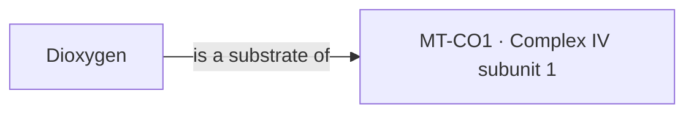

# Hive visualisation

**Quest.** What are the fundamental reactions of human respiration?

**Interpretation and pair.** How does mitochondrial complex IV use oxygen as the terminal electron acceptor? Query `oxygen` and `MT-CO1`. [Biomiv JSON](https://biomiv.com/api/v1/healthspan/network/connect?a=oxygen&b=MT-CO1)

**Biomiv inference map**

**Judgment.** The substrate link fits intact complex IV. Coherence is **2/3**. Biomiv returned the pair and relationship. The mitochondrial setting came from the quest.

**Reaction.** `O₂ + 4 e⁻ + 4 H⁺ → 2 H₂O`. Complex IV takes electrons from cytochrome c and uses them to turn oxygen into water.

## Weighted elements

The curator assigns each node a weight on two 1–3 axes after reviewing the Biomiv reply.

| Accuracy ↓ / Coherence → | 1 | 2 | 3 |
| --- | --- | --- | --- |
| 1 | — | — | — |
| 2 | — | Dioxygen | — |
| 3 | — | MT-CO1 | — |

Dioxygen gets accuracy 2 because Biomiv labels it a plant compound. MT-CO1 gets accuracy 3 because Biomiv identifies the catalytic subunit. Both get coherence 2 because the reply leaves the setting unspecified.

[Reaction reference cited by Biomiv](https://www.rhea-db.org/rhea/11436) · [Inference ledger](investigations/inferences.jsonl)
